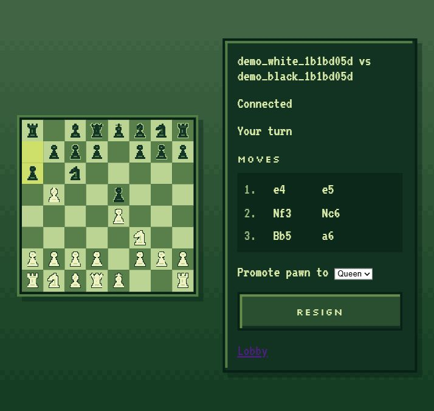
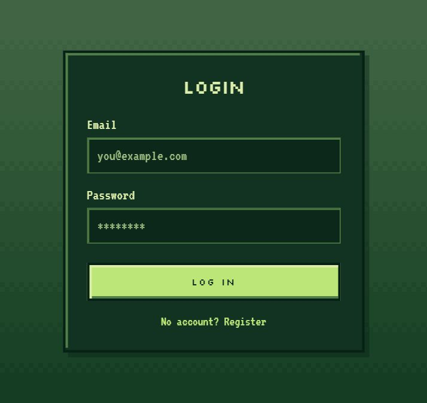

# petChess

petChess — работающая веб-версия шахмат для двух игроков с пиксельным
интерфейсом. Игроки создают партии и находят соперника через лобби. Сервер
проверяет каждый ход по правилам шахмат и сохраняет позицию и историю в
PostgreSQL. После обновления страницы или переподключения партию можно
продолжить.

**Статус:** рабочий MVP. [Играть онлайн](https://pet-chess.hostless.app).

## Функциональность

- Регистрация, вход и управление данными аккаунта.
- Создание партии и присоединение второго игрока.
- Проверка ходов на сервере, включая рокировку, взятие на проходе и превращение пешки.
- Определение мата и ничьей, сдача и просмотр истории партий.
- Передача ходов и обновление состояния партии через WebSocket/STOMP.
- Восстановление партии после обновления страницы и переподключения.

## Этапы разработки

| Этап | Результат | Статус |
|---|---|---|
| Основа проекта и данные | Настроены локальная PostgreSQL в Docker, модели пользователей, партий и ходов | Завершён |
| Авторизация и игровой сервер | Реализованы JWT, игровое API, проверка правил и сохранение ходов | Завершён |
| Игра в реальном времени | Добавлены WebSocket-события и восстановление состояния при переподключении | Завершён |
| Интерфейс | Готовы регистрация, лобби, доска, настройки аккаунта и история партий | Завершён |
| Проверка и публикация | Пройдены сборки и тесты; публичная версия развёрнута на Hostless с базой Neon | Завершён |

Публичную версию проверили двумя аккаунтами: игроки присоединились к одной
партии, обменялись ходами, обновили страницу и увидели результат в истории.

## Скриншоты

### Игровая партия

Пример активной партии с историей ходов.



### Вход



## Технологии

**Бэкенд** — Java 21, Spring Boot, Spring Security, Spring Data JPA, JWT, chesslib, Gradle.

**Фронтенд** — React, TypeScript, Vite, React Router, STOMP.js.

**База данных** — PostgreSQL 16 в Docker при локальном запуске, Neon PostgreSQL
в публичной версии.

## Онлайн-игра

1. Откройте [pet-chess.hostless.app](https://pet-chess.hostless.app) с двух
   устройств или в обычном окне и режиме инкогнито. Каждый игрок регистрирует
   свой аккаунт.
2. Первый игрок нажимает **Create game** в лобби и ждёт соперника.
3. Второй игрок нажимает **Refresh games** и выбирает **Join** у созданной партии.
4. Игроки делают ходы, выбирая фигуру и клетку назначения. Позиция и список
   ходов обновляются у обоих в реальном времени.

После обновления страницы партия восстанавливается. Завершённые партии доступны
в разделе **Match History**.

## Локальный запуск

Для локального запуска необходимы JDK 21, Node.js с npm и Docker Desktop.
Команды выполняются в отдельных терминалах. Начните из корня репозитория.

**1. Запустите базу данных**

```sh
docker compose up -d --wait db
```

**2. Запустите бэкенд**

```powershell
cd backend/main-service
.\gradlew.bat bootRun
```

На Linux и macOS используйте `./gradlew bootRun`.

**3. Запустите фронтенд**

```sh
cd frontend
npm ci
npm run dev
```

Приложение откроется по адресу [localhost:3000](http://localhost:3000).
Бэкенд использует порт 8080, PostgreSQL — 5433. Данные БД сохраняются
в постоянном томе Docker.

Чтобы проверить локальную версию на одном компьютере, откройте
`http://localhost:3000` в обычном окне и режиме инкогнито. Зарегистрируйте
два аккаунта и выполните шаги 2–4 из раздела «Онлайн-игра».

## Сборка и тестирование

При запущенной Docker-БД выполните в `backend/main-service` команду
`./gradlew build` или `.\gradlew.bat build` в Windows.
Команда собирает бэкенд и запускает тесты игровой логики, хранения данных,
HTTP API и обмена сообщениями по STOMP.

В `frontend` выполните `npm run build` для проверки TypeScript и сборки сайта.

Описание эндпоинтов и событий находится в [документации API](docs/api.md).
Подготовка публичной версии описана в [инструкции по развёртыванию](docs/deployment.md).

## Дальнейшее развитие

Следующий этап — улучшить визуальное оформление и удобство игры. В дальнейшем
планируются шахматные часы, предложение ничьей, рейтинг и автоматические
проверки при изменениях в репозитории.
